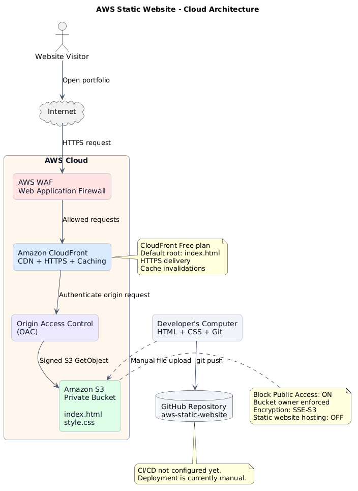

# AWS Static Website Hosting with Amazon S3 & CloudFront

A secure, globally distributed static portfolio website built using Amazon Web Services (AWS).

## Project Overview

This project demonstrates how to host a static website on AWS using Amazon S3 for object storage and Amazon CloudFront for content delivery.

The architecture follows AWS security best practices by keeping the S3 bucket private and allowing CloudFront to retrieve website content through Origin Access Control (OAC).

**Live Website:** [https://dzc0bep0iz73h.cloudfront.net/#projects]

## Architecture



**Request flow:**

1. A visitor opens the website through the CloudFront HTTPS endpoint.
2. CloudFront checks whether the requested content is cached.
3. On a cache miss, CloudFront securely requests the object from Amazon S3.
4. Origin Access Control (OAC) authenticates CloudFront's requests to the private S3 bucket.
5. CloudFront delivers the content to the visitor.

## Technologies Used

| Technology | Purpose |
|---|---|
| Amazon S3 | Stores static website files |
| Amazon CloudFront | CDN, HTTPS delivery, and caching |
| Origin Access Control | Secure access between CloudFront and S3 |
| AWS WAF | Included web security protections |
| Git & GitHub | Source control and project documentation |
| HTML & CSS | Website content and styling |
| AWS Budgets | Cost monitoring and budget alerts |

## Security Implementation

- S3 Block Public Access remains enabled.
- S3 Object Ownership uses Bucket owner enforced.
- S3 objects use server-side encryption with SSE-S3.
- CloudFront accesses S3 through Origin Access Control.
- The bucket policy restricts object access to the authorized CloudFront distribution.
- CloudFront provides HTTPS access to website visitors.
- Included AWS WAF protections are enabled.

## Deployment Process

### 1. Create the S3 bucket

- Create a general-purpose S3 bucket.
- Enable Block Public Access.
- Keep ACLs disabled.
- Use SSE-S3 encryption.
- Leave S3 static website hosting disabled.

### 2. Upload website files

Upload `index.html` and `style.css` to the root of the bucket.

### 3. Configure CloudFront

- Create a CloudFront distribution.
- Select the existing S3 bucket as the origin.
- Enable private bucket access using OAC.
- Use the recommended cache settings.
- Configure `index.html` as the default root object.
- Enable HTTPS delivery.

### 4. Configure S3 permissions

Verify that the bucket policy grants `s3:GetObject` permission to the CloudFront service principal, restricted to the distribution ARN.

### 5. Test the website

Open the CloudFront distribution domain using HTTPS and verify that the HTML and CSS load correctly.

## Updating the Website

1. Modify the website files locally.
2. Commit and push the changes to GitHub.
3. Upload updated files to S3.
4. Create a CloudFront invalidation for changed paths.
5. Verify the updated website over HTTPS.

Example Git workflow:

```bash
git add .
git commit -m "Update portfolio website"
git push origin main
```

Example CloudFront invalidation paths:

```text
/
/index.html
/style.css
```

Only invalidate paths whose content has changed.

## Testing and Validation

- [x] Website loads over HTTPS.
- [x] HTML and CSS files load successfully.
- [x] S3 bucket remains private.
- [x] CloudFront OAC configured.
- [x] Updated content delivered after invalidation.
- [x] CloudFront response headers inspected.

## Challenges and Lessons Learned

**GitHub authentication:** An initial `git push` failed because GitHub rejected the stored credentials. I configured Git Credential Manager and authenticated through the browser to successfully push the repository.

**CloudFront caching:** Updating files in S3 did not automatically guarantee immediate delivery of the new version. I learned how CloudFront caching works and used invalidations to refresh the content.

**Security:** I learned how to make a website publicly accessible without exposing its underlying S3 bucket to anonymous users.

## Cost Considerations

The CloudFront Free plan was selected for this project. S3 storage, requests, and other AWS services may incur separate charges depending on usage.

An AWS Budget was configured to monitor spending. Budget notifications do not automatically stop resource usage.

## Future Improvements

- Automate deployment using GitHub Actions.
- Introduce Infrastructure as Code with Terraform.
- Configure a custom domain using Route 53.
- Add automated testing and security checks.
- Improve caching using versioned static assets.

## Key Takeaways

This project provided hands-on experience with AWS object storage, CDN architecture, HTTPS, IAM-based access controls, caching, deployment workflows, and cloud cost awareness.

It is the first project in my Cloud Engineering portfolio, focused on developing practical infrastructure and DevOps skills.